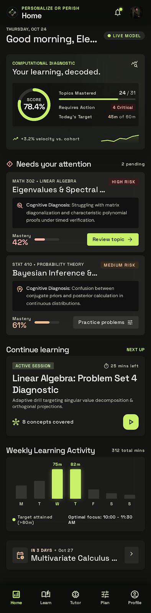
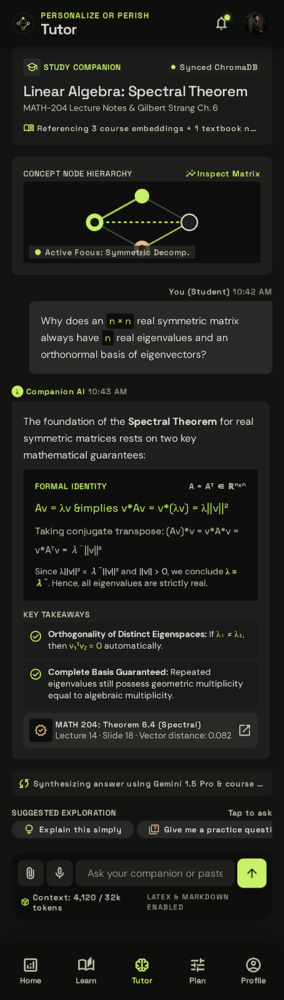
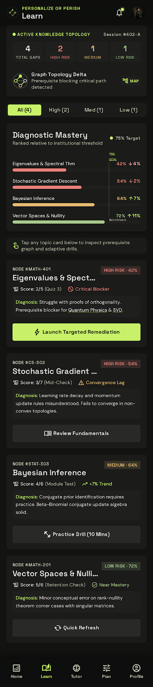
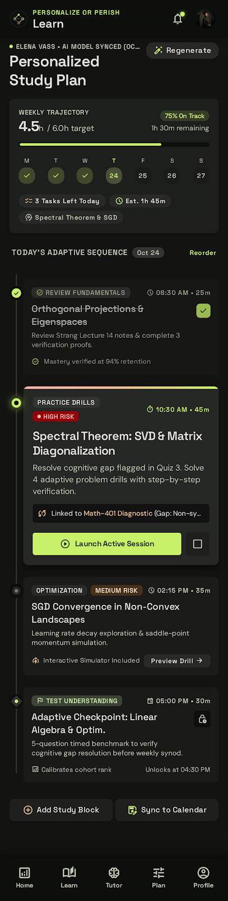
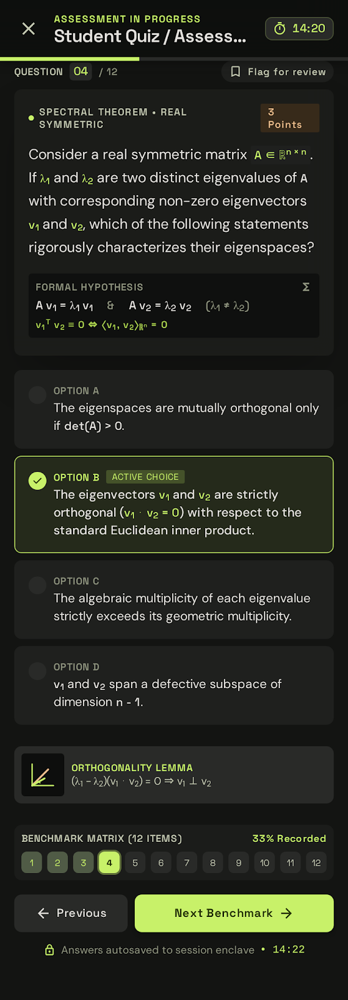
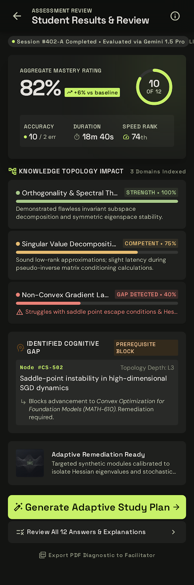
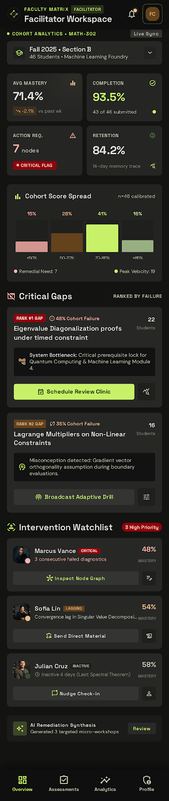
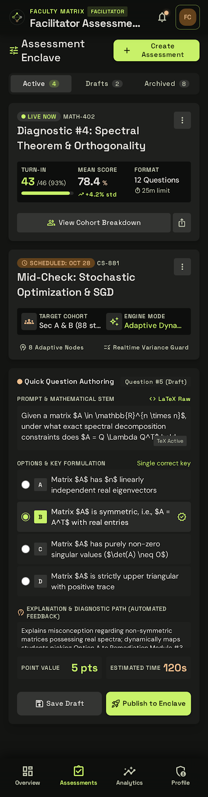
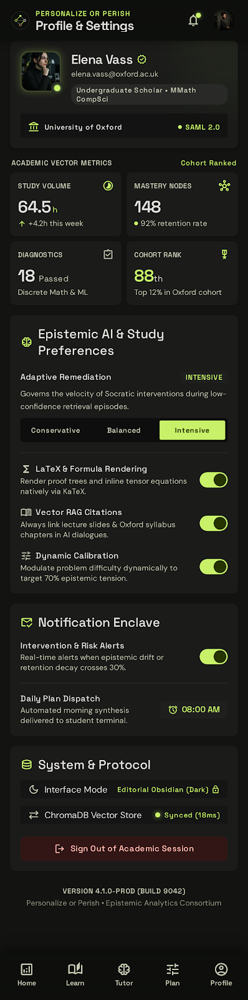

# Upthink — Think beyond memorization

> **Upthink** is an AI-powered academic intelligence and learning analytics platform built with Flutter, powered by Supabase and Google Gemini. Upthink helps college students diagnose and remediate learning gaps, receive personalized AI tutoring grounded in course documents, generate adaptive study plans, practice through diagnostic assessments, and track academic trajectory. Facilitators can author assessments, monitor cohort performance, identify systemic misconceptions, and deploy targeted interventions.

---

## 1. System Architecture & Tech Stack

- **Frontend Framework:** Flutter 3.38+ & Dart 3.10+
- **State Management:** Riverpod 3.x (`AsyncNotifier`, `Notifier`, `ProviderScope`)
- **Routing & Navigation:** `GoRouter` with role-aware guards (`STUDENT` vs `FACILITATOR`)
- **Backend & Database:** Supabase (Auth, PostgreSQL DB, Row-Level Security, Storage, Edge Functions)
- **AI Intelligence:** Google Gemini API (`gemini-1.5-flash` / `gemini-1.5-pro` via protected Supabase Edge Functions)
- **Charts & Visualizations:** `fl_chart`
- **Typography:** Google Fonts (`Space Grotesk` for analytical headings & metrics, `DM Sans` for body & explanations)
- **Markdown & Formulas:** `flutter_markdown`

---

## 2. Directory Structure

```text
lib/
├── app.dart                                # Upthink root application widget & theme binding
├── main.dart                               # Application entrypoint & initialization
├── core/
│   ├── config/
│   │   └── app_config.dart                 # Environment variables and runtime configuration
│   ├── routing/
│   │   └── app_router.dart                 # Role-aware GoRouter specification with shells
│   ├── theme/
│   │   ├── app_colors.dart                 # Editorial Obsidian & Acid Lime color palette
│   │   ├── app_theme.dart                  # Material 3 dark theme definition
│   │   └── app_typography.dart             # Space Grotesk and DM Sans typography scale
│   └── widgets/
│       ├── app_bottom_navigation.dart      # 5-destination student navigation with lime indicator
│       ├── app_header.dart                 # Analytical top application bar with status dots
│       ├── feedback_views.dart             # Loading, error, and empty state feedback widgets
│       ├── glass_panel.dart                # Restrained dark glassmorphism container
│       ├── mastery_bar.dart                # Dynamic mastery bar with benchmark target markers
│       ├── metric_card.dart                # High-density numerical stat card
│       ├── progress_ring.dart              # Circular gauge indicator with accent glow
│       ├── section_header.dart             # Analytical section title with metadata tags
│       ├── severity_badge.dart             # HIGH, MEDIUM, LOW severity pills
│       ├── shell_scaffold.dart             # Shell container with bottom navigation
│       └── upthink_logo.dart               # Geometric lattice logo and Upthink wordmark
├── features/
│   ├── assessments/
│   │   ├── data/assessment_repository.dart # Assessment query and server-side submission
│   │   ├── presentation/
│   │   │   ├── assessment_results_screen.dart # Screen 6: Diagnostic Results
│   │   │   └── quiz_assessment_screen.dart    # Screen 5: Interactive Quiz
│   │   └── providers/assessment_provider.dart # Quiz state notifier and timer logic
│   ├── auth/
│   │   ├── data/auth_repository.dart       # Supabase Auth client & demo profiles
│   │   ├── presentation/auth_screen.dart   # Sign-in, sign-up, and role selection
│   │   └── providers/auth_provider.dart    # Auth state notifier
│   ├── dashboard/
│   │   ├── data/dashboard_repository.dart  # Aggregate student metrics & activity
│   │   ├── presentation/student_dashboard_screen.dart # Screen 1: Student Dashboard
│   │   └── providers/dashboard_provider.dart
│   ├── facilitator/
│   │   ├── data/facilitator_repository.dart
│   │   ├── presentation/
│   │   │   ├── assessment_authoring_screen.dart # Screen 8: Assessment Authoring
│   │   │   └── facilitator_dashboard_screen.dart # Screen 7: Cohort Analytics
│   │   └── providers/facilitator_provider.dart
│   ├── learning_gaps/
│   │   ├── data/learning_gap_repository.dart # Diagnostic breakdown & prerequisites
│   │   ├── presentation/learning_gaps_screen.dart # Screen 3: Learning Gaps Diagnostic
│   │   └── providers/learning_gap_provider.dart
│   ├── profile/
│   │   ├── data/profile_repository.dart    # Settings persistence & syllabus upload
│   │   ├── presentation/profile_screen.dart # Screen 9: Profile & Settings
│   │   └── providers/profile_provider.dart
│   ├── study_plans/
│   │   ├── data/study_plan_repository.dart # Study plan queries & regeneration
│   │   ├── presentation/study_plan_screen.dart # Screen 4: Adaptive Study Plan
│   │   └── providers/study_plan_provider.dart
│   └── tutor/
│       ├── data/tutor_repository.dart      # Tutor chat & RAG citations
│       ├── presentation/ai_tutor_screen.dart # Screen 2: AI Tutor Companion
│       └── providers/tutor_provider.dart
└── shared/
    ├── models/
    │   ├── app_user.dart                   # Student and Facilitator profile models
    │   ├── assessment.dart                 # Assessment, question, and result models
    │   ├── cohort.dart                     # Cohort and section metrics models
    │   ├── learning_gap.dart               # Diagnostic gap and severity models
    │   ├── study_plan.dart                 # Plan and task completion models
    │   └── tutor_message.dart              # Messages and RAG citation models
    └── services/
        ├── gemini_service.dart             # Edge function invocation service
        └── supabase_service.dart           # Supabase client wrapper and offline fallback
```

---

## 3. Faithful Screen-by-Screen Implementation

All 9 Stitch designs from `stitch_personalize_or_perish.zip` have been faithfully converted into modular Flutter screens:

### Visual Design Showcase

| Screen | Stitch Visual Specification | Architecture & Capabilities |
|---|:---:|---|
| **1. Student Dashboard**<br>`/dashboard` |  | Analytical header, overall circular mastery progress ring (`82%`), ranked learning gaps, quick-resume learning module, weekly 7-day activity chart, and bottom navigation. |
| **2. AI Tutor Companion**<br>`/tutor` |  | Academic Markdown chat, numbered derivations, formula blocks, key takeaways, verifiable source citations from syllabus documents, and keyboard-safe composer. |
| **3. Learning Gaps Diagnostic**<br>`/learning-gaps` |  | Severity filters (`All`, `High`, `Medium`, `Resolved`), mastery benchmark bars, ranked topic cards, and prerequisite dependency inspection. |
| **4. Personalized Study Plan**<br>`/study-plan` |  | Weekly progress card (`4.5h / 6.0h`, 75% on track), AI plan regeneration trigger, and interactive task checklist grouped by pedagogical objective. |
| **5. Interactive Quiz Assessment**<br>`/quiz` |  | Timed diagnostic enclave (`14:20`), question progress dots, prompt stem with formal hypothesis, 4-option selection with Acid Lime indicator, and review flagging. |
| **6. Assessment Diagnostic Results**<br>`/results` |  | Aggregate mastery (`82%`, `+6%` delta), velocity rank (74th percentile), topic domain breakdown, and cognitive gap knowledge topology. |
| **7. Facilitator Cohort Dashboard**<br>`/cohort` |  | Cohort selector, 4-metric overview grid (Avg Mastery `71.4%`, Completion `93.5%`, Action Required `7`), score distribution bar chart, and cohort-wide critical gaps. |
| **8. Assessment Management & Authoring**<br>`/authoring` |  | Dual-tab workspace (`Live & Scheduled` vs. `Drafts`), turn-in rate metrics, and interactive 4-step modal question authoring dialog. |
| **9. Profile & Academic Settings**<br>`/profile` |  | Scholar identity, study volume (`64.5h`), role switcher, remediation intensity segment selector, cognitive engine toggles, and syllabus document upload enclave. |

---

## 4. Supabase Backend Implementation

### SQL Migrations (`supabase/migrations/`)

1. **`20261025000001_initial_schema.sql`:**
   - Enables `pgvector` extension for semantic document retrieval.
   - Creates tables: `profiles`, `topics`, `cohorts`, `cohort_enrollments`, `learning_gaps`, `study_plans`, `study_tasks`, `assessments`, `assessment_questions`, `assessment_attempts`, `submissions`, `documents`, `document_chunks`, `tutor_conversations`, `tutor_messages`.
   - Establishes UUID primary keys, foreign key constraints, indexes, and updated-at triggers.

2. **`20261025000002_rls_policies.sql`:**
   - Enables Row Level Security (RLS) on all tables.
   - Prevents student access to authoritative answer keys (`correct_option` and `explanation` on unsubmitted assessments).
   - Grants facilitators full authoring and cohort monitoring rights for assigned classes.
   - Protects study plans, attempts, and conversations with user-ownership policies.

3. **`20261025000003_seed_data.sql`:**
   - Seeds realistic academic topics (`Linear Algebra`, `Signal Processing`, `Computer Systems`).
   - Seeds active and draft assessments, complete with 12 rigorous questions.
   - Seeds initial cohort and student enrollment data.

---

## 5. Protected Gemini Edge Functions (`supabase/functions/`)

To protect API credentials, all Gemini AI operations run server-side via Supabase Edge Functions:

1. **`tutor-chat`:**
   - Receives student conversation prompt and conversation ID.
   - Retrieves authorized document chunks via cosine similarity on embeddings.
   - Constructs grounded system prompt with verified citations.
   - Calls Gemini `gemini-1.5-flash` and returns response with source citations.

2. **`study-plan-generate`:**
   - Evaluates student's verified high-severity learning gaps.
   - Prompts Gemini with strict JSON schema to generate structured tasks (`PRACTICE`, `REVIEW`, `STRENGTHEN`).
   - Validates generated JSON before persisting tasks to PostgreSQL.

3. **`grade-assessment`:**
   - Receives student's selected answers and duration.
   - Compares with server-side authoritative answer keys (never exposed to client).
   - Calculates score, accuracy, domain impact, and diagnoses cognitive gaps.
   - Persists attempt results and automatically identifies new learning gaps.

4. **`document-indexer`:**
   - Chunks syllabus / course PDF text into 500-token passages.
   - Generates 768-dimension embeddings using `text-embedding-004`.
   - Stores vectors in `document_chunks` for fast semantic retrieval.

---

## 6. How to Run & Verify

### Prerequisites
- Flutter SDK (3.38+ recommended)
- Dart SDK (3.10+ recommended)

### Run Tests
```bash
# Run static analysis (0 issues verified)
flutter analyze

# Run unit and widget tests
flutter test
```

### Launch the Application
```bash
# Launch with live Supabase credentials:
flutter run \
  --dart-define=SUPABASE_URL=https://your-project.supabase.co \
  --dart-define=SUPABASE_PUBLISHABLE_KEY=your-supabase-publishable-key \
  --dart-define=GEMINI_API_KEY=YOUR_GEMINI_API_KEY

# Or launch directly in offline / demo verification mode (works out of the box):
flutter run
```

---

## 7. Design System Compliance

| Design Token | Value | Applied Element |
|---|---|---|
| **Canvas** | `#10110F` | Main app background |
| **Surface Low** | `#171916` | Content cards & panels |
| **Surface High** | `#20231F` | Elevated dialogs & active tabs |
| **Primary Accent** | `#C8F169` | Acid Lime buttons, badges & indicators |
| **Text High Contrast** | `#F0F0E7` | Primary headlines & values |
| **Text Medium Contrast** | `#A2A69A` | Descriptions & metadata |
| **High Risk** | `#E98278` | Critical learning gaps |
| **Medium Risk** | `#E6BC72` | Moderate learning gaps |
| **Low Risk** | `#A9C98B` | Remediated topics |
| **Headings Font** | `Space Grotesk` | Headings, metrics, and labels |
| **Body Font** | `DM Sans` | Explanations, questions, and body |
